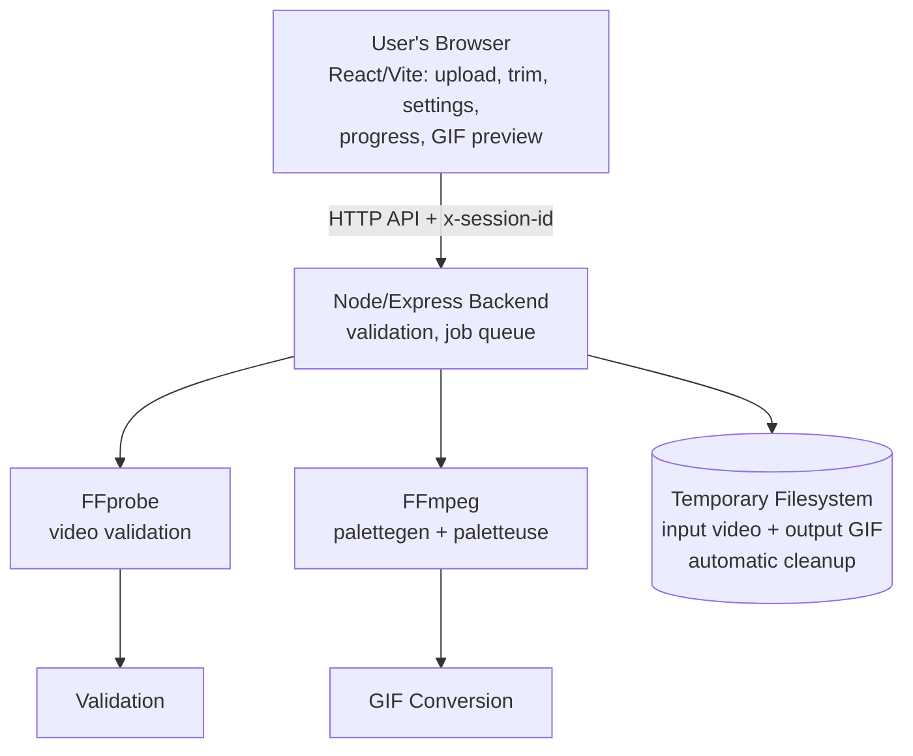

# Clip2GIF — Video to GIF Converter

Turn short video clips into optimized, infinitely-looping animated GIFs. Upload → trim → tune settings → convert → preview → download → auto-cleanup. No accounts, no database, no permanent storage.

- **Frontend:** React + Vite + TypeScript + Tailwind CSS + Lucide icons
- **Backend:** Node.js + Express + TypeScript, real FFmpeg conversion (`palettegen` + `paletteuse`), FFprobe validation
- **Storage:** ephemeral local temp filesystem only (`/tmp/clip2gif/<job-uuid>/`), automatic expiry, manual + post-download cleanup

> Browser = preview/selection only. All validation + conversion happens on the backend. A restart may delete temp files and in-memory jobs.

## Features

- Drag-and-drop upload (MP4/MOV/WebM/AVI/MKV/M4V), local preview before upload, duration detection
- Trim with sliders + numeric inputs, validation against actual duration and max clip length (default 120s; 60s+ supported)
- GIF settings: max dimension 320/480/640 (aspect preserved), fps 5–15, quality small/balanced/high (real palette settings), infinite loop
- Job-based async API with real progress (FFmpeg `time=` parsing, indeterminate fallback), queue (1 active + 3 queued by default)
- Preview via authenticated blob fetch, download with optional auto-clear, per-job delete, clear-all with confirm dialog
- Session isolation via `x-session-id` header, rate limits, CORS allowlist, helmet, `Cache-Control: no-store`, safe `spawn()` args, server-generated paths
- Cold-start handling (backoff + elapsed timer + retry), expired-job handling, responsive dark UI, toasts, accessible dialogs
- Cleanup service: TTL expiry (30 min), failed/cancelled/abandoned removal, post-download session clear

## Limits (defaults, all env-configurable)

| Setting | Default | Env |
|---|---|---|
| Max upload | 100 MB | `MAX_UPLOAD_MB` |
| Max source duration | 600s | `MAX_SOURCE_DURATION_SECONDS` |
| Max clip segment | 120s | `MAX_CLIP_DURATION_SECONDS` |
| Max GIF output | 50 MB | `MAX_GIF_OUTPUT_MB` |
| Active conversions | 1 | `MAX_ACTIVE_CONVERSIONS` |
| Queued jobs | 3 | `MAX_QUEUED_JOBS` |
| Output TTL | 30 min | `TEMP_FILE_TTL_MINUTES` |
| Job timeout | 900s | `JOB_TIMEOUT_SECONDS` |
| Cleanup interval | 5 min | `CLEANUP_INTERVAL_MINUTES` |
| Temp dir | OS tmp/clip2gif | `TEMP_DIR` |

`GET /api/limits` returns the live values so the UI never hardcodes them.

## Local setup (Windows)

1. Install Node.js 18+ from https://nodejs.org
2. `npm run install:all` (or `npm install` in `backend/` and `frontend/`)
3. Copy env: `copy .env.example backend\.env` (backend loads `.env` via dotenv; or set env vars in shell). For frontend dev, create `frontend\.env` with `VITE_API_BASE_URL=http://localhost:5000` if needed.
4. Start backend: `npm run dev:backend` (http://localhost:5000, `/api/health`)
5. Start frontend: `npm run dev:frontend` (http://localhost:5173)
6. Open the frontend, select a video, trim (e.g. 10s→70s = 60s segment), Convert, preview, Download.
7. FFmpeg binaries come from `ffmpeg-static` / `ffprobe-static` (Windows + Linux included) — no global install needed. Check startup logs for `ffmpeg=... exists=true`.

Root commands: `npm run dev`, `npm run build`, `npm test`, `npm run test:long` (60s integration, opt-in).

## Testing

- Backend: `npm --prefix backend run test` — health, limits, validation units, session/auth, format rejection, non-video rejection, real 3s FFmpeg conversion (synthetic `testsrc` video, GIF magic-byte check, source deletion, preview, download+autoclear, clear-all).
- Long test: `npm --prefix backend run test:long` — 61s synthetic video → 60s GIF. Cheap settings (128×96, 5fps, small). Run before release; skipped by default.
- Frontend: `npm --prefix frontend run test` — upload/remove, trim validation, settings changes, progress states, errors, cold start.
- Typecheck/build: `tsc --noEmit` + `vite build` / `tsc` in each package.

## Render deployment (free tier)

Architecture: **Static Site (frontend)** + **Free Web Service (backend)** + ephemeral temp FS. No DB, no disk, no object storage.

1. Push this repo to GitHub.
2. In Render, **New → Blueprint**, select the repo (uses `render.yaml`), or create services manually:
   - Backend: Web Service, Root Directory `backend`, Build `npm install && npm run build`, Start `npm run start`. Health check `/api/health`.
   - Frontend: Static Site, Root Directory `frontend`, Build `npm install && npm run build`, Publish `dist`.
3. Backend env: `NODE_ENV=production`, `TEMP_DIR=/tmp/clip2gif`, `FRONTEND_ORIGIN=https://<your-frontend>.onrender.com`, plus limits as desired. `PORT` is provided by Render automatically.
4. Frontend env: `VITE_API_BASE_URL=https://<your-backend>.onrender.com` (rebuild after setting).
5. Deploy backend first, verify `https://<backend>/api/health` → `{"success":true,...}`, then deploy frontend.
6. Do a real conversion on the live URL before sharing.

Troubleshooting: build fails → check Node version ≥18 and both `package.json` installs; FFmpeg missing → `ffmpeg-static`/`ffprobe-static` postinstall must run on Linux (check logs for `exists=true`); CORS errors → `FRONTEND_ORIGIN` must exactly match the frontend URL; cold starts → first load can take ~1 min, the UI shows a wake-up notice; lost jobs after deploy/restart → expected (in-memory + ephemeral), start again.

**Free-tier notes:** 1 conversion at a time, conservative 480px/10fps defaults, processing may take longer than playback (a 60s clip is supported but not guaranteed fast). No keep-alive hacks — sleeping is normal.

## API

All `/api/jobs*` require `x-session-id: <random-token>` (frontend generates + stores in `sessionStorage`; never in URLs).

- `GET /api/health` → `{success,data:{status:'ok',...}}`
- `GET /api/limits` → live limits
- `POST /api/jobs` (multipart `video` + `start,end,width,fps,quality`) → 201 `{job}`
- `GET /api/jobs` → session job list
- `GET /api/jobs/:id` → job status/progress/output
- `POST /api/jobs/:id/cancel`
- `GET /api/jobs/:id/preview` (image/gif)
- `GET /api/jobs/:id/download?autoclear=1` (attachment; clears session after stream when autoclear)
- `DELETE /api/jobs/:id`, `DELETE /api/jobs` (clear session)

Errors: `{success:false,error:{code,message}}` with proper status codes (`FILE_TOO_LARGE`, `UNSUPPORTED_FORMAT`, `INVALID_VIDEO`, `TRIM_TOO_LONG`, `QUEUE_FULL`, `OUTPUT_TOO_LARGE`, `EXPIRED`, `FORBIDDEN`, …). No paths/stack traces leak to clients.

## Security & privacy

- Extension + FFprobe content validation, size/duration/trim/settings allowlists, server-generated filenames, isolated per-job dirs, `safeJoin` traversal guard, `spawn()` arg arrays (no shell), timeouts + kills, bounded in-memory registry.
- Session token is a temporary capability, not identity; UUID job IDs alone grant nothing (ownership checked on every route); rate-limited; CORS allowlist; `Cache-Control: no-store` on job/media responses.
- Privacy: video stays local until Convert; server keeps files only for preview/download (~30 min) then deletes; restarts may wipe sooner; manual clear anytime; no analytics. Not “fully anonymous” — the host inevitably sees transient uploads.

## Known limitations

- In-memory job registry: restart loses jobs (UI explains + offers restart).
- Ephemeral FS: no persistence by design.
- GIF is inherently large: long/high-fps/high-res clips may hit the 50 MB cap — retry smaller.
- `render.yaml` follows the documented Blueprint schema but has not been live-verified here; adjust service names/URLs to your account.
