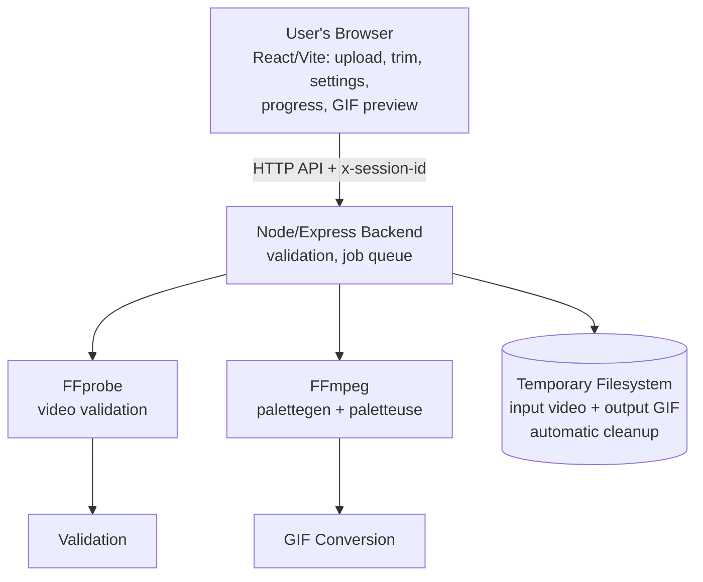

# Clip2GIF — Video to GIF Converter

Turn short video clips into optimized, infinitely-looping animated GIFs. Upload → trim → tune settings → convert → preview → download → auto-cleanup. No accounts, no database, no permanent storage.

- **Frontend:** React + Vite + TypeScript + Tailwind CSS + Lucide icons
- **Backend:** Node.js + Express + TypeScript, real FFmpeg conversion (`palettegen` + `paletteuse`), FFprobe validation
- **Storage:** ephemeral local temp filesystem only (`/tmp/clip2gif/<job-uuid>/`), automatic expiry, manual + post-download cleanup

> Browser = preview/selection only. All validation + conversion happens on the backend. A restart may delete temp files and in-memory jobs.

## Features

- Drag-and-drop upload (MP4/MOV/WebM/AVI/MKV/M4V), local preview before upload, duration detection
- Trim with sliders + numeric inputs, validation against actual duration and max clip length (default 120s; 60s+ supported)
- Quality presets (Tiny/Compact/Balanced/High/Max) + Custom advanced panel: max dimension 240–800px, fps 5–20, palette 64–256 colors, dithering (sierra2_4a/floyd_steinberg/bayer/none), optional Optimize-file-size with 5–20 MB targets
- Job-based async API with real progress (`-progress pipe:1` + stderr fallback, per-stage weighting), queue (1 active + 3 queued by default)
- Result panel with actual output size, dimensions, fps, palette/dither used, attempts, conversion time, and source-vs-output comparison
- Preview via authenticated blob fetch, download with optional auto-clear, per-job delete, clear-all with confirm dialog
- Session isolation via `x-session-id` header, rate limits, CORS allowlist, helmet, `Cache-Control: no-store`, safe `spawn()` args, server-generated paths
- Cold-start handling (backoff + elapsed timer + retry), expired-job handling, responsive dark UI, toasts, accessible dialogs
- Cleanup service: TTL expiry (30 min), failed/cancelled/abandoned removal, post-download session clear

## Limits (defaults, all env-configurable)

| Setting | Default | Env |
|---|---|---|
| Max upload | 100 MB | `MAX_UPLOAD_MB` |
| Max source duration | 600s | `MAX_SOURCE_DURATION_SECONDS` |
| Max clip segment | 120s | `MAX_CLIP_DURATION_SECONDS` |
| Max GIF output | 50 MB | `MAX_GIF_OUTPUT_MB` |
| Active conversions | 1 | `MAX_ACTIVE_CONVERSIONS` |
| Queued jobs | 3 | `MAX_QUEUED_JOBS` |
| Output TTL | 30 min | `TEMP_FILE_TTL_MINUTES` |
| Job timeout | 900s | `JOB_TIMEOUT_SECONDS` |
| Cleanup interval | 5 min | `CLEANUP_INTERVAL_MINUTES` |
| Temp dir | OS tmp/clip2gif | `TEMP_DIR` |
| Default preset | balanced | `DEFAULT_PRESET` |

`GET /api/limits` returns the live values so the UI never hardcodes them.

## Quality presets & encoding pipeline

Each preset maps to REAL encoder settings (backend is authoritative; invalid values are rejected, never silently swapped):

| Preset | Max dim | FPS | Colors | Dither | Intent |
|---|---|---|---|---|---|
| Tiny | 320 | 6 | 96 | bayer | smallest files |
| Compact | 320 | 8 | 128 | bayer | compact, smooth |
| Balanced | 480 | 10 | 192 | sierra2_4a | default trade-off |
| High | 640 | 12 | 256 | sierra2_4a | detail + motion |
| Max | 640 | 15 | 256 | sierra2_4a | fidelity first (not lossless!) |
| Custom | 240–800 | 5–20 | 64–256 | any of 4 | full control |

Pipeline (two-stage, `spawn()` arg arrays, input seeking so only the segment is decoded):
1. **Palette:** `-ss start -t dur -i input -vf "fps,F,scale=W:W:lanczos:force_original_aspect_ratio=decrease,palettegen=max_colors=N:reserve_transparent=1:stats_mode=diff" -frames:v 1 palette.png`
2. **Encode:** same `-ss/-t`, `-lavfi "fps,F,scale…[a];[a][1:v]paletteuse=dither=D:diff_mode=rectangle"` → GIF (encoder defaults `offsetting+transdiff`, infinite loop).
3. Palette PNG deleted immediately after use; partial outputs removed on failure/retry.

Why this shape (measured — see `backend/bench/REPORT.md`): `reserve_transparent=1` re-enables transparency frame-differencing (−24% size alone); `stats_mode=diff` + `diff_mode=rectangle` focuses the palette on changed regions (−28% combined); two-stage output is byte-identical to single-pass at equal settings but peaks at ~78 MB RSS instead of ~517 MB on a 28s 360x640 clip (single-pass `split` buffers the whole clip — fatal on 512 MB Free tier and the likely cause of multi-minute conversions). Bayer suits size-first presets (smaller + faster, equal PSNR); sierra2_4a suits quality-first ones. Dither `none` is smallest but can band gradients.

**Optimize file size** (optional): pick a target (5/10/15/20 MB or custom 1–50). If the GIF exceeds it, the backend retries at most twice with a documented downgrade ladder (lower fps+colors, then also width) and reports the effective settings + attempt count + honest `sizeNote` if the target still wasn't reached. Hard cap `MAX_GIF_OUTPUT_MB` (50) always enforced.

**Why is the GIF bigger than my video?** GIF stores ≤256 colors per frame with 1980s-era compression; modern codecs (H.264 etc.) are 10–50× more efficient. A 28s 360x640@15fps GIF legitimately reaches tens of MB. Reduce fps/dimensions/colors, shorten the clip, or enable Optimize file size.

Reproduce benchmarks: `node bench/bench.mjs portrait` (from `backend/`; needs `npm install` for the bundled FFmpeg). Results vary by machine and content — synthetic `testsrc2` is high-motion, not photo content.

## Local setup (Windows)

1. Install Node.js 18+ from https://nodejs.org
2. `npm run install:all` (or `npm install` in `backend/` and `frontend/`)
3. Copy env templates: `copy backend\.env.example backend\.env` and `copy frontend\.env.example frontend\.env.development.local` (defaults already point at each other; see Environment Configuration below).
4. Start backend: `npm run dev:backend` (http://localhost:5000, `/api/health`)
5. Start frontend: `npm run dev:frontend` (http://localhost:5173)
6. Open the frontend, select a video, trim (e.g. 10s→70s = 60s segment), Convert, preview, Download.
7. FFmpeg binaries come from `ffmpeg-static` / `ffprobe-static` (Windows + Linux included) — no global install needed. Check startup logs for `ffmpeg=... exists=true`.

Root commands: `npm run dev`, `npm run build`, `npm test`, `npm run test:long` (60s integration, opt-in).

## Testing

- Backend: `npm --prefix backend run test` — health, limits, trim/preset/custom/optimize validation units, downgrade-ladder unit, session/auth, format rejection, non-video rejection, real 3s two-stage FFmpeg conversion (synthetic `testsrc` video, GIF magic-byte check, palette-cleanup check, source deletion, output-metadata check, preview, download+autoclear, clear-all).
- Long test: `npm --prefix backend run test:long` — 61s synthetic video → 60s GIF via the two-stage pipeline. Run before release; skipped by default.
- Frontend: `npm --prefix frontend run test` — upload/remove, trim validation, preset select, advanced custom editing, optimize toggle, risk warning (no fake MB claims), result metadata, progress states, errors, cold start.
- Benchmarks: `node bench/bench.mjs portrait` (from `backend/`) — full report in `backend/bench/REPORT.md`.
- Typecheck/build: `tsc --noEmit` + `vite build` / `tsc` in each package.

## Environment Configuration: Local vs Production

Each app owns its environment. There is **no root `.env`** — the root `.env.example` is only a pointer.

| Variable | Owner | Local location | Production location | Purpose |
|---|---|---|---|---|
| `NODE_ENV` | backend (runtime) | `backend/.env` | Render backend env (`production`) | dev-vs-prod behavior (localhost CORS fallback) |
| `PORT` | backend (runtime) | `backend/.env` (`5000`) | Platform-provided by Render (do not hardcode) | Backend listening port |
| `FRONTEND_ORIGIN` | backend (runtime) | `backend/.env` (`http://localhost:5173`) | Render backend env → public frontend URL | CORS allowlist (never `*`) |
| `VITE_API_BASE_URL` | frontend (**build-time**) | `frontend/.env.development.local` (`http://localhost:5000`) | Vercel project env → public backend URL, then **redeploy** | API base embedded in client bundle |
| `TEMP_DIR` | backend (runtime) | `backend/.env` (empty = OS tmp fallback) | Render backend env (`/tmp/clip2gif`) | Ephemeral job directory |
| `MAX_UPLOAD_MB` | backend | `backend/.env` | Render backend env | Upload cap (default 100) |
| `MAX_SOURCE_DURATION_SECONDS` | backend | `backend/.env` | Render backend env | Source cap (default 600) |
| `MAX_CLIP_DURATION_SECONDS` | backend | `backend/.env` | Render backend env | Segment cap (default 120) |
| `MAX_GIF_OUTPUT_MB` | backend | `backend/.env` | Render backend env | Hard output cap (default 50) |
| `MAX_ACTIVE_CONVERSIONS` / `MAX_QUEUED_JOBS` | backend | `backend/.env` | Render backend env | Queue bounds (default 1 / 3) |
| `TEMP_FILE_TTL_MINUTES` / `JOB_TIMEOUT_SECONDS` / `CLEANUP_INTERVAL_MINUTES` | backend | `backend/.env` | Render backend env | Expiry/timeout/cleanup (30 / 900 / 5) |
| `DEFAULT_PRESET` | backend | `backend/.env` (`balanced`) | Render backend env | Server default preset; frontend has no competing default (adopts server value from `/api/limits`) |

Rules:

- **Backend** loads `backend/.env` via a path resolved from the backend package itself, so it works from any working directory and in compiled `dist/` output. Real env vars (Render, shell, tests) always win — dotenv never overrides them; a missing file (production) is a no-op. Invalid values fail fast at startup with a clear error.
- **Frontend** uses plain Vite conventions (no extra dotenv code): `frontend/.env.development.local` for local dev, Vercel project env for production. `VITE_*` values are **public build-time config baked into the JS bundle — never secrets**.
- Local `.env` files are git-ignored; `*.env.example` templates are committed.
- Local dev never touches production: frontend `http://localhost:5173` → backend `http://localhost:5000` (direct URL from `.env.development.local`; the Vite `/api` proxy is a fallback when the variable is empty).

Production wiring (manual — Render Blueprint cannot safely auto-wire a **public** backend URL; `fromService … property: host` yields the internal hostname, which browsers can't reach):

1. Deploy the backend, copy its public URL (`https://<name>.onrender.com`).
2. Vercel project → **Settings → Environment Variables** → set `VITE_API_BASE_URL` to that URL → **redeploy** (Vite embeds it at build time; changing it requires a fresh build).
3. Render Dashboard → **clip2gif-backend → Environment** → set `FRONTEND_ORIGIN` to the Vercel frontend's public URL.
4. Verify: `https://<backend>/api/health` → `{"success":true,…}`; then convert once on the live frontend.

Troubleshooting CORS/API-URL errors:

- Browser calls `localhost:5000` on the live site → production frontend wasn't rebuilt after setting `VITE_API_BASE_URL`. Redeploy it.
- `403 Origin not allowed` / CORS error → `FRONTEND_ORIGIN` on the backend doesn't exactly match the frontend origin (scheme + host, no trailing slash).
- Local frontend can't reach backend → is the backend running on `:5000`? Check `frontend/.env.development.local`.
- Backend ignores `backend/.env` edits → restart the dev process (tsx reads it at startup); confirm CWD-independent loading works from the repo root.

## Render deployment (free tier)

Architecture: **Render Web Service (backend)** + **Vercel (frontend)** + ephemeral temp FS. No DB, no disk, no object storage. `render.yaml` defines the backend service only — there is intentionally no Render static site, so no duplicate frontend is deployed.

Use these exact backend settings (Blueprint via `render.yaml`, or the same values manually):

- Repository: `https://github.com/adrneol/clip2gif`, branch `main`
- Root Directory: `backend`
- Build Command: `npm install --include=dev && npm run build` (builds `backend/dist/server.js` via `tsc`; `--include=dev` is required because `NODE_ENV=production` would otherwise skip `typescript`)
- Start Command: `npm run start` (runs `node dist/server.js` relative to `backend/`)
- Health Check Path: `/api/health` (real endpoint, verified in `backend/src/routes/api.ts`)
- Environment: `NODE_ENV=production`, `TEMP_DIR=/tmp/clip2gif`, `DEFAULT_PRESET=balanced`, plus limits as desired. `PORT` is provided by Render automatically — never hardcode it. `FRONTEND_ORIGIN` ← set to the real Vercel frontend URL **after** deploying the frontend (leave the placeholder until then; localhost origins only work in non-production builds).

Vercel frontend: set `VITE_API_BASE_URL` to the public Render backend URL (`https://<your-backend>.onrender.com`) in the Vercel project settings and redeploy (Vite embeds it at build time).

1. Push `main` to GitHub.
2. Render → **New → Blueprint** (or Web Service with the settings above).
3. Confirm the build log shows `tsc` completing and `dist/server.js` emitted.
4. Verify `https://<backend>/api/health` → `{"success":true,...}` and `/api/limits` shows production values.
5. Deploy the frontend to Vercel, then set `FRONTEND_ORIGIN` on the backend to the Vercel URL.
6. Do a real conversion on the live frontend before sharing.

**Blueprint vs manual service (important).** Services created *manually* in the Dashboard do NOT inherit later `render.yaml` changes — a stale manual Build Command (empty, or install-only) is exactly what produces `Cannot find module '.../backend/dist/server.js'` after a "successful" build. Before redeploying, open Dashboard → clip2gif-backend → Settings and confirm: Root Directory `backend`, Build Command `npm install --include=dev && npm run build`, Start Command `npm run start`. Alternatively delete nothing — just fix the values in place (no service deletion needed) — or recreate the service via **New → Blueprint** so `render.yaml` stays authoritative (recreating changes the service URL; fixing in place does not).

**Deploying the right commit.** On the Render deploy screen, confirm the deployed commit SHA matches `main` HEAD on GitHub (`git rev-parse main`). If it shows an older commit, use **Manual Deploy → Deploy latest commit**. If builds look stale, use **Manual Deploy → Clear build cache & deploy**.

**What success looks like.** Build log: `npm ci`-style install, `tsc` with no errors, no `[clip2gif] dist/... not found` line. Runtime log: `[clip2gif] backend listening on 0.0.0.0:<PORT> (production)`, `tempDir=/tmp/clip2gif`, `ffmpeg=... exists=true`, `ffprobe=... exists=true`. Safety nets now in the repo: `npm run build` fails if `dist/server.js` is missing; `npm run start` compiles it automatically when absent (needs devDependencies) and only then boots; CI (`.github/workflows/ci.yml`) and `backend/tests/deploy.test.ts` lock the build→start contract on every push.

Troubleshooting: `Cannot find module '.../backend/dist/server.js'` at startup → the production build never ran (most common cause: manual service with an empty/wrong Build Command, or the Blueprint not applied — see above). Current code self-heals this when devDependencies are present (`npm run start` compiles automatically); if it still fails, fix the Build Command and redeploy. Build fails → check Node version ≥18 and `--include=dev`; FFmpeg missing → `ffmpeg-static`/`ffprobe-static` must install the Linux binaries (check logs for `exists=true`; Render runtime availability is otherwise unverified — see Known limitations); CORS errors → `FRONTEND_ORIGIN` must exactly match the Vercel origin; cold starts → first load can take ~1 min, the UI shows a wake-up notice; lost jobs after deploy/restart → expected (in-memory + ephemeral), start again.

**Free-tier notes:** 1 conversion at a time, conservative 480px/10fps defaults, processing may take longer than playback (a 60s clip is supported but not guaranteed fast). No keep-alive hacks — sleeping is normal.

## API

All `/api/jobs*` require `x-session-id: <random-token>` (frontend generates + stores in `sessionStorage`; never in URLs).

- `GET /api/health` → `{success,data:{status:'ok',...}}`
- `GET /api/limits` → live limits
- `POST /api/jobs` (multipart `video` + `start,end,preset[,width,fps,colors,dither,optimize,targetMB]`) → 201 `{job}`. Legacy `quality` (small/balanced/high) still accepted as preset aliases. Job `output` reports effective `{sizeBytes,width,height,duration,fps,colors,dither,preset,conversionMs,attempts,sizeNote}`.
- `GET /api/jobs` → session job list
- `GET /api/jobs/:id` → job status/progress/output
- `POST /api/jobs/:id/cancel`
- `GET /api/jobs/:id/preview` (image/gif)
- `GET /api/jobs/:id/download?autoclear=1` (attachment; clears session after stream when autoclear)
- `DELETE /api/jobs/:id`, `DELETE /api/jobs` (clear session)

Errors: `{success:false,error:{code,message}}` with proper status codes (`FILE_TOO_LARGE`, `UNSUPPORTED_FORMAT`, `INVALID_VIDEO`, `TRIM_TOO_LONG`, `QUEUE_FULL`, `OUTPUT_TOO_LARGE`, `EXPIRED`, `FORBIDDEN`, …). No paths/stack traces leak to clients.

## Security & privacy

- Extension + FFprobe content validation, size/duration/trim/settings allowlists, server-generated filenames, isolated per-job dirs, `safeJoin` traversal guard, `spawn()` arg arrays (no shell), timeouts + kills, bounded in-memory registry.
- Session token is a temporary capability, not identity; UUID job IDs alone grant nothing (ownership checked on every route); rate-limited; CORS allowlist; `Cache-Control: no-store` on job/media responses.
- Privacy: video stays local until Convert; server keeps files only for preview/download (~30 min) then deletes; restarts may wipe sooner; manual clear anytime; no analytics. Not “fully anonymous” — the host inevitably sees transient uploads.

## Known limitations

- In-memory job registry: restart loses jobs (UI explains + offers restart).
- Ephemeral FS: no persistence by design.
- GIF is inherently large: long/high-fps/high-res clips may hit the 50 MB cap — retry smaller.
- `render.yaml` follows the documented Blueprint schema but has not been live-verified here; adjust service names/URLs to your account.
- FFmpeg on Render Linux is provisioned by `ffmpeg-static`'s install-time download (network required at build) plus in-tarball `ffprobe-static` binaries — verified present as a mechanism, but actual Linux execution can only be confirmed from the live service's boot log (`ffmpeg=... exists=true`) and a real conversion.
